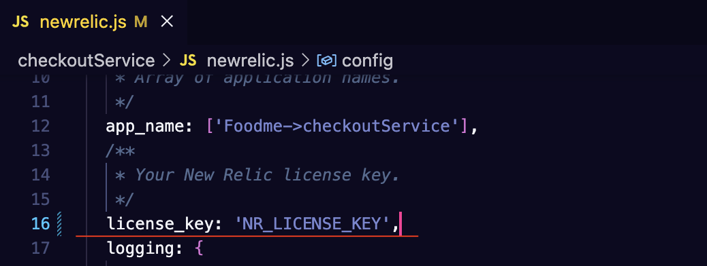
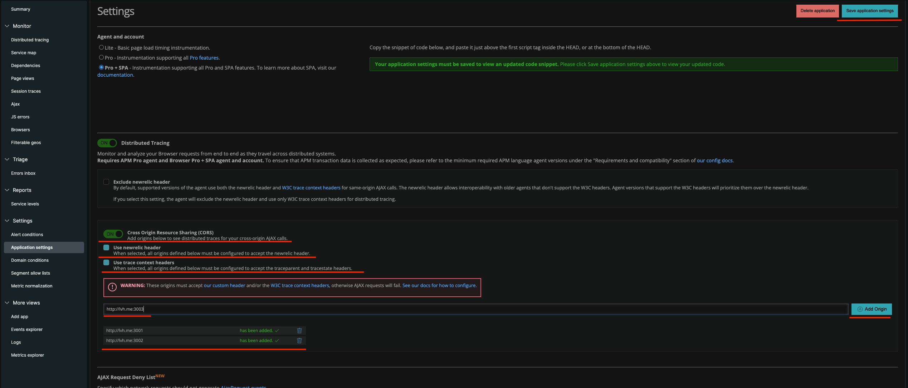

[](https://opensource.newrelic.com/oss-category/#new-relic-experimental)

# [Relicstaurants] [build badges go here when available]

> The Relicstaurants repository was created so that you can test New Relic observability on a small but real project. You don't have to create a special application just to practice, we did it for you. So go ahead and copy the repository, run it locally and try to implement observability for this project yourself. You can find a tip on what the finished project looks like on the "observability" branch

## Installation

```make
 make install
```

## Getting Started

```make
 make run
```

## APM Distributed Tracing

To enable distributed tracing for the backend parts of this application, add your New Relic License key to the following files:

- [Checkout Service](checkoutService/newrelic.js#L16)
- [Menu Service](menuService/newrelic.js#L16)
- [Restaurant Service](restaurantService/newrelic.js#L16)

 Example:

 

### Documentation:
* [Introduction to New Relic for Node.js](https://docs.newrelic.com/docs/apm/agents/nodejs-agent/getting-started/introduction-new-relic-nodejs/)
* [Node.js agent configuration](https://docs.newrelic.com/docs/apm/agents/nodejs-agent/installation-configuration/nodejs-agent-configuration/)
* [Distributed tracing for Node.js](https://docs.newrelic.com/docs/apm/agents/nodejs-agent/installation-configuration/distributed-tracing-nodejs-agent/) 
* [Example distributed tracing instrumented app in Node](https://github.com/newrelic/newrelic-node-examples/tree/0a036fd669b4b47b8afbc7add8696980f799f0da/custom-instrumentation/distributed-tracing)

## Browser Distributed Tracing
### Documentation:

* [Installing browser agent](https://docs.newrelic.com/docs/browser/browser-monitoring/installation/install-browser-monitoring-agent/)

*Note*: Javascript snippet should be then pasted as close to the top of the [index.html](public/index.html#L6) file. See guidance here for more details on [where to place Javascript snippet](https://docs.newrelic.com/docs/browser/new-relic-browser/page-load-timing-resources/instrumentation-browser-monitoring/#javascript-placement)

### Recommendations: 
Enable "Cross Origin Resource Sharing(CORS)", "Use newrelic header", "Use trace context headers" 
Add the backend origins to enable newrelic headers to be passed between the frontend app and the backend ones
Be sure to "Save application settings" as seen in :



After saving that change, Distributed Tracing Browser data should be available once the app is running.


## Infrastructure and logs:
### Documentation:

* [Infrastructure guided install](https://docs.newrelic.com/docs/infrastructure/infrastructure-agent/new-relic-guided-install-overview/)
* [Node.js agent logs in context](https://docs.newrelic.com/docs/logs/logs-context/configure-logs-context-nodejs/)

## To troubleshoot: 
### Documentation:

* [Troubleshooting Browser monitoring installation](https://docs.newrelic.com/docs/browser/browser-monitoring/troubleshooting/troubleshoot-your-browser-monitoring-installation/)
* [Diagnosing issues/troubleshooting with nrdiag](https://docs.newrelic.com/docs/new-relic-solutions/solve-common-issues/diagnostics-cli-nrdiag/diagnostics-cli-nrdiag/)

## Contributing

We encourage your contributions to improve [project name]! Keep in mind when you submit your pull request, you'll need to sign the CLA via the click-through using CLA-Assistant. You only have to sign the CLA one time per project.
If you have any questions, or to execute our corporate CLA, required if your contribution is on behalf of a company, please drop us an email at opensource@newrelic.com.

### **A note about vulnerabilities**

As noted in our [security policy](../../security/policy), New Relic is committed to the privacy and security of our customers and their data. We believe that providing coordinated disclosure by security researchers and engaging with the security community are important means to achieve our security goals.

If you believe you have found a security vulnerability in this project or any of New Relic's products or websites, we welcome and greatly appreciate you reporting it to New Relic through [HackerOne](https://hackerone.com/newrelic).

## License

[Project Name] is licensed under the [Apache 2.0](http://apache.org/licenses/LICENSE-2.0.txt) License.

> [If applicable: The [project name] also uses source code from third-party libraries. You can find full details on which libraries are used and the terms under which they are licensed in the third-party notices document.]
